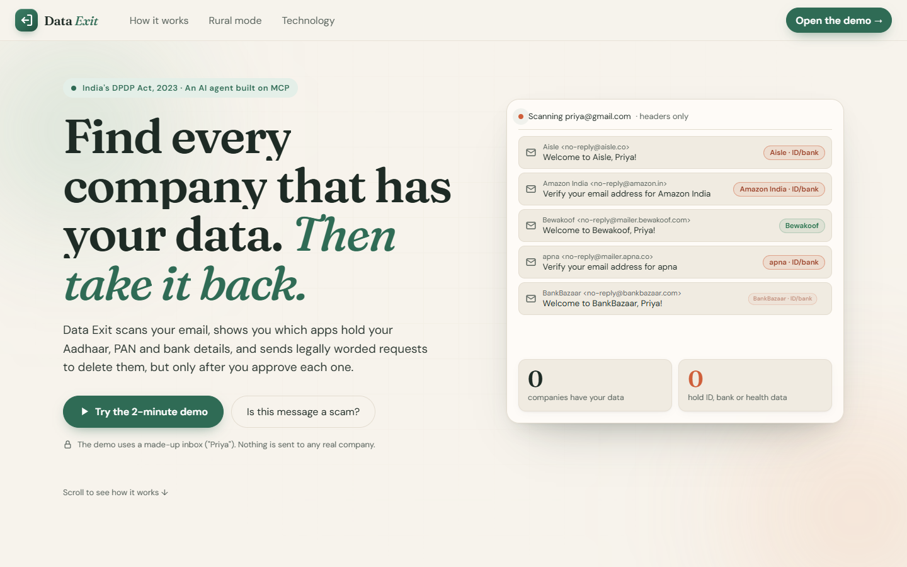
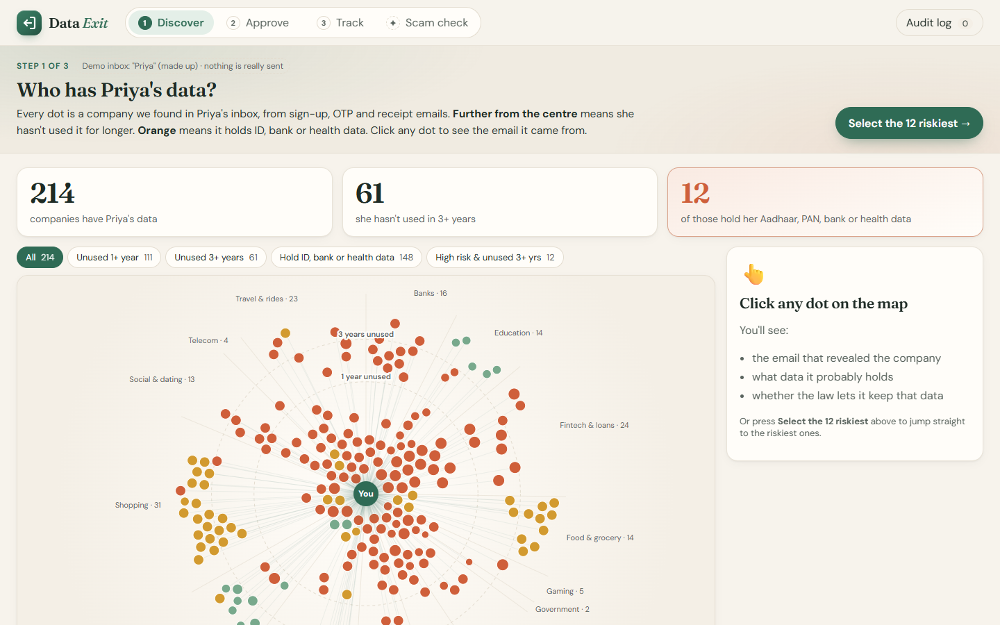
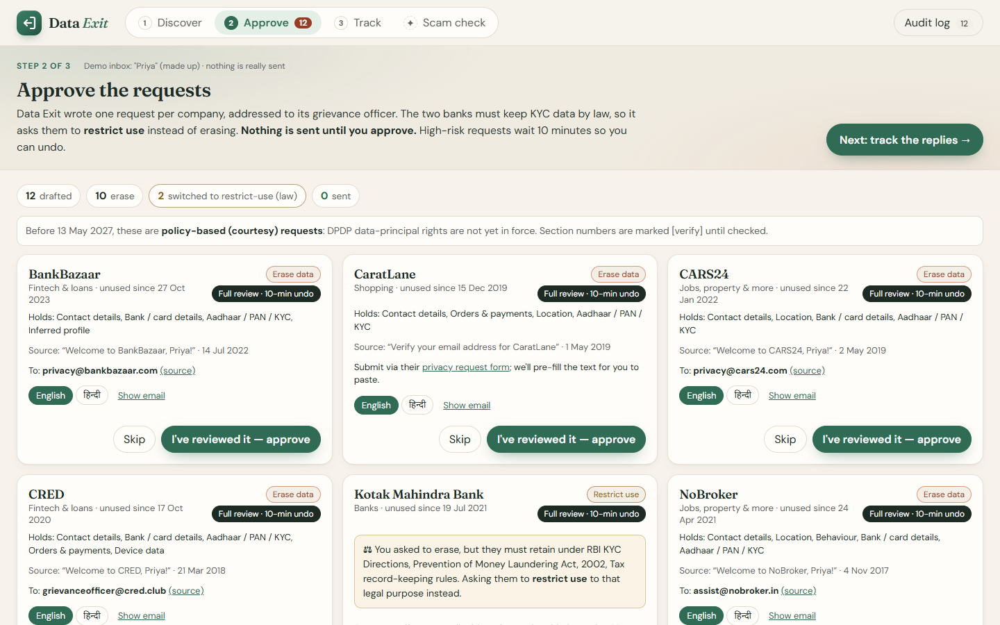
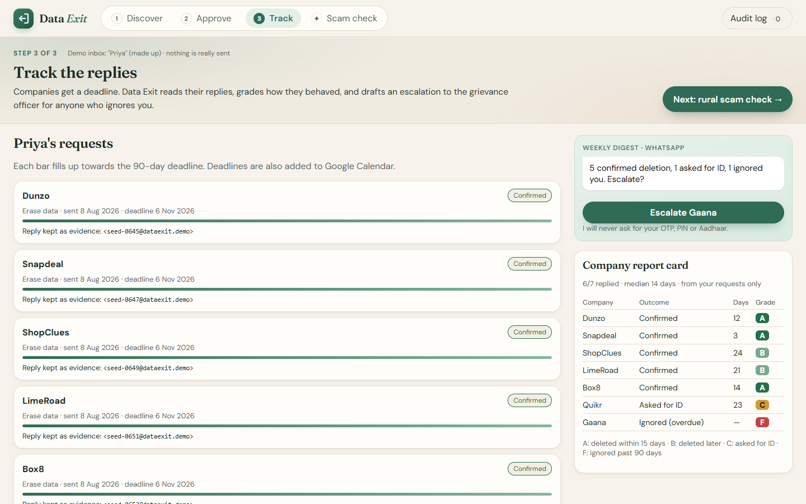
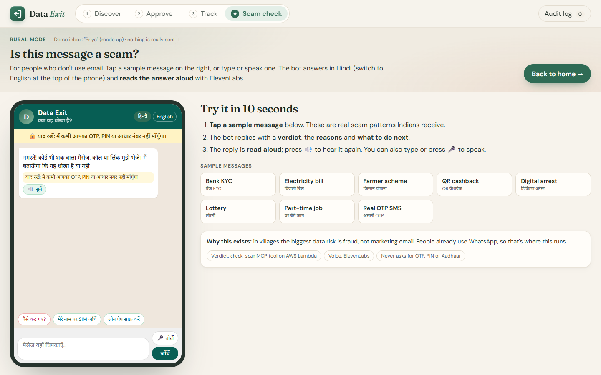
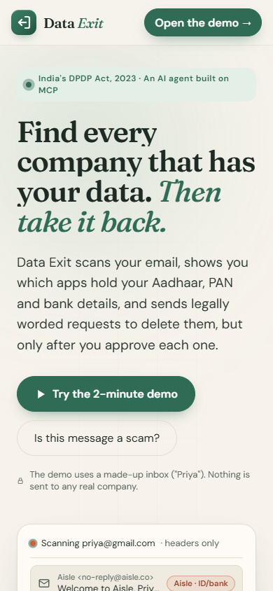

# Data Exit

**Take your data back.** Data Exit is an MCP-powered agent that finds every company holding an Indian user's personal data, then helps them withdraw consent, correct it, restrict it or erase it under the **DPDP Act, 2023**. It works inside apps people already use (Gmail, Calendar, WhatsApp), and the user approves every sensitive action.

**Rural mode** turns the same agent into a voice-first scam shield: forward a suspicious SMS or say it out loud, and hear back in Hindi or Kannada whether it is a scam and what to do next.

> City users need to take back their data. Village users need to stop losing their savings. The same agent does both.

wHACKiest 2026 · **Track 1: Make MCP Matter** · Bonus tracks: **Best Use of AWS**, **Best Use of ElevenLabs** · Team **Data Exit**, Dr. Ambedkar Institute of Technology

### ▶ Live demo: https://isozxdci5aem2ewbe7utcwv6i40oulpk.lambda-url.ap-south-1.on.aws/

| Jump to | What you'll see |
| --- | --- |
| [Landing page](https://isozxdci5aem2ewbe7utcwv6i40oulpk.lambda-url.ap-south-1.on.aws/) | What Data Exit does in plain language: the problem, your DPDP rights, how it works, safety rules, rural mode |
| [Data map](https://isozxdci5aem2ewbe7utcwv6i40oulpk.lambda-url.ap-south-1.on.aws/#map) | 214 companies found in a demo inbox, 61 unused for 3+ years, 12 holding Aadhaar, PAN, bank or health data |
| [Review & approve](https://isozxdci5aem2ewbe7utcwv6i40oulpk.lambda-url.ap-south-1.on.aws/#review-demo) | 12 drafted requests: 10 erase, 2 banks switched to restrict-use by RBI KYC rules, 10-minute undo, audit log |
| [Tracker](https://isozxdci5aem2ewbe7utcwv6i40oulpk.lambda-url.ap-south-1.on.aws/#tracker) | Replies classified, WhatsApp-style digest, one-tap escalation to the grievance officer, company report card |
| [Rural: scam check](https://isozxdci5aem2ewbe7utcwv6i40oulpk.lambda-url.ap-south-1.on.aws/#rural) | Tap a sample or speak; the verdict comes from `check_scam` on AWS Lambda and is read aloud by ElevenLabs |

The live site uses a seeded demo persona ("Priya Demo"), never a real inbox. Nothing is sent to any company: `SEND_MODE=sandbox`.

| Landing page | Step 1: Discover (data map) |
| --- | --- |
|  |  |
| **Step 2: Approve (Kotak switched to restrict-use)** | **Step 3: Track (escalate Gaana)** |
|  |  |
| **Rural: scam check, live verdict from AWS Lambda** | **On a phone** |
|  |  |

## The problem

- **69%** of Indians don't know they can take back consent they gave to a company (PwC India survey of 3,233 consumers, Oct 2024).
- **1 in 5** families with a UPI user was hit by UPI fraud in the last 3 years, and half never complained (LocalCircles, Jun 2025).
- **₹4,058 crore** lost to "digital arrest" scams since 2022 (government data, to May 2026).
Sources for every number: [docs/research/sources.md](docs/research/sources.md).

- The DPDP Act gives every Indian the right to withdraw consent, access, correct and erase their data. But nobody knows *which* companies hold their data, *who* to write to, or *what* to say.

## What Data Exit does (the five-step loop)

1. **Discover.** Reads Gmail *headers only* (signup, OTP, receipt and welcome emails) and matches senders against a 290-company Indian directory. No email bodies are stored.
2. **Prioritise.** Scores each company 0–100 on data sensitivity (Aadhaar, PAN, bank, health), breadth and dormancy, and draws a data map.
3. **Draft.** Writes the right request (withdraw consent, access, correct, erase, restrict) in English or Hindi, addressed to the verified grievance officer, citing the email it came from.
4. **Approve and send.** Approval tiers decide what needs a tap and what needs a full review. Erasure and anything to a bank, insurer, hospital or government body gets full review and a 10-minute undo. Sends go from the user's own Gmail, with a Calendar reminder at the deadline.
5. **Follow through.** Classifies replies (confirmed, ID requested, refused for retention, redirected), escalates to the grievance officer and drafts a Data Protection Board complaint, exports an evidence ZIP, and sends a weekly digest.

**It knows the law.** RBI KYC, PMLA, SEBI, telecom, insurance and medical retention rules turn an erase request into restrict-use, so a bank's lawful refusal isn't a dead end. Tax records are not exempt. Before 13 May 2027 (when data-principal rights take effect), every request is labelled a policy-based (courtesy) request.

## Why MCP (Track 1)

Data Exit is 23 MCP tools across five servers, orchestrated by Claude. It goes well beyond wrapping one API:

```
discover_footprint ─▶ lookup_company ─▶ get_retention_rules ─▶ draft_request ─▶ approve_request ─▶ send_request
   (Gmail, headers)     (directory)        (legal reasoning)      (EN/HI templates)   (policy tiers)     (Gmail + Calendar)
                                                                                                             │
weekly_digest ◀─ escalate_request ◀─ classify_reply ◀─ check_replies ◀───────────────────────────────────────┘
check_scam (rural mode)    export_evidence    get_audit_log (hash-chained)    delete_my_data
```

Every tool call goes through `packages/policy`: an approval-tier check plus an audit event in a SHA-256 hash chain. The agent cannot send anything the user hasn't approved. Details: [docs/architecture/mcp-servers.md](docs/architecture/mcp-servers.md).

## Sponsor technology

| | Built and live today | Next (pilot) |
| --- | --- | --- |
| **AWS** | Live MVP on **AWS Lambda (ap-south-1, Mumbai)** behind a Function URL. One function serves the web app, runs the real `check_scam` MCP code at `/api/check`, and proxies ElevenLabs at `/api/tts` so the key never reaches the browser. Deploy bundle in S3. | One Lambda per MCP server behind API Gateway; Step Functions + EventBridge for the 30/90-day request clocks; RDS Postgres (schema in [db/schema.sql](db/schema.sql)); S3 Object Lock + KMS for the evidence locker; Cognito + SNS. |
| **ElevenLabs** | **Multilingual TTS** reads every rural-mode verdict aloud in Hindi and English, and **Kannada** via `eleven_v3`. Browser voice fallback if offline. | **Scribe** speech-to-text for voice notes in Kannada and Hindi; **ElevenLabs Agents + Twilio** missed-call helpline for feature-phone users. |

Deployment details: [docs/architecture/deployment-aws.md](docs/architecture/deployment-aws.md).

## What's real and what's mocked

| Part | Status |
| --- | --- |
| MCP servers (discovery, directory, request engine, tracker, scam shield) | **Real.** Built and tested: `npm test` runs 16 tests (unit, Postgres store contract, end-to-end, MCP protocol). |
| Gmail discovery and sending, Calendar deadlines | **Real** via our own OAuth client. Offline fixture backend for demos (`GMAIL_BACKEND=fixture`). Live sends are disabled (`SEND_MODE=sandbox`). |
| Policy layer: tiers, 10-minute undo, hash-chained audit | **Real**, in `packages/policy`, and mirrored in the web UI (SubtleCrypto SHA-256). |
| Company directory | **Real data**: 290 Indian companies. 7 grievance contacts verified from each company's privacy policy; the rest are `verified: false` and never guessed. |
| `check_scam` + ElevenLabs voice | **Real and live** on AWS Lambda. |
| Web app (data map, approvals, tracker) | **Real UI on seeded data**: a deterministic demo inbox of 656 messages. Next step: point `apps/web/src/api.ts` at the MCP HTTP server. |
| WhatsApp bot, SMS on Android, missed-call line | **Designed, not built.** The rural UI is a WhatsApp-style mock-up. |

## Quality, measured

| Lighthouse | Performance | Accessibility | Best practices | SEO |
| --- | --- | --- | --- | --- |
| Desktop | 97 | 100 | 100 | 100 |
| Mobile | 90 | 100 | 100 | 100 |

16/16 tests pass · 0 console errors across all views · accessibility 100 on all 5 views · works at 390 px wide. Details and before/after: [docs/hackathon/metrics.md](docs/hackathon/metrics.md).

## Run it locally

Node 22+.

```bash
npm install
npm test            # build + 16 tests
npm run demo:seed   # regenerate the demo inbox and the web app's mock data
npm run web         # web app at http://127.0.0.1:5173
npm start           # all MCP tools in one server over stdio (Claude Code reads .mcp.json)
npm run start:http  # same over HTTP for claude.ai custom connectors (needs MCP_HTTP_SECRET)
```

Connect to Claude Desktop, claude.ai or real Gmail: [docs/development/setup.md](docs/development/setup.md). Redeploy the live site: [docs/architecture/deployment-aws.md](docs/architecture/deployment-aws.md).

## Repository layout

```
apps/web/                  Web app: data map (D3), review & approve, tracker, rural scam check (Vite + TypeScript)
infra/voice-lambda/        AWS Lambda: serves the web app, /api/check, /api/tts (ElevenLabs)
packages/
  shared/                  Contract types, sensitivity scoring, DPDP constants
  policy/                  Approval tiers, approval state machine, hash-chained audit log
  store/                   JSON-file and Postgres stores
  google/                  OAuth, Gmail (headers-only search, UTF-8 send), Calendar, offline fixtures
  directory/               Directory loader: domains, SMS sender IDs, brand merge
  runtime/                 Config, logging, context, MCP tool wrapper
servers/
  discovery/               discover_footprint, get_data_map, check_new_signups
  company-directory/       lookup_company, get_retention_rules (+ data/companies.csv, 290 companies)
  request-engine/          draft / approve / undo / reject / send + EN/HI templates
  tracker/                 replies, escalation, evidence ZIP, digest, audit, delete
  scam-shield/             check_scam (rural mode)
  dataexit/                all tools in one server (stdio or --http) + CLI scripts
demo/seed-inbox/           Deterministic demo inbox generator (656 messages)
db/schema.sql              Postgres schema
tests/                     unit, store contract, end-to-end, MCP protocol
docs/                      Product, legal, architecture, hackathon (start at docs/README.md)
```

## Safety and privacy by design

- Gmail **metadata first**; email bodies are never stored. SMS would be parsed on the device.
- **Never** asks for OTP, PIN or Aadhaar, and says so in every rural-mode reply.
- No grievance contact is invented. Unverified contacts are flagged, and the request is blocked until a recipient is confirmed.
- Every suggestion cites the email it came from.
- `delete_my_data` wipes everything Data Exit stored about the user.

## Team

Team ID: **43af82f0** · Dr. Ambedkar Institute of Technology

| Member | Role |
| --- | --- |
| Abhishek M Shivanagoudar (lead) | Agent, MCP servers, AWS |
| Sanvi Y Gowda | WhatsApp, ElevenLabs voice |
| Afreen Hossain | Web app and data map |
| Rithikha R | Company directory, request templates, demo data |

Plan and status: [docs/hackathon/build-plan.md](docs/hackathon/build-plan.md) · Submission checklist: [docs/hackathon/submission.md](docs/hackathon/submission.md)

## Disclaimer

Data Exit is not a legal service. Request templates are drafts that need a lawyer's review before real use; DPDP section numbers are marked `[verify]`. Before **13 May 2027**, data-principal rights under the DPDP Rules are not yet in force, so requests sent before then are policy-based (courtesy) requests.
