<div align="center">

# Data Exit

### Find every company that has your data. Then take it back.

An MCP-powered agent that helps Indian users find out which companies hold their personal data and use their rights under the **DPDP Act, 2023**.
It works inside apps people already use (Gmail, Calendar, WhatsApp), and **nothing is sent until the user approves it**.

[](https://isozxdci5aem2ewbe7utcwv6i40oulpk.lambda-url.ap-south-1.on.aws/)


**City users need to take back their data. Village users need to stop losing their savings. The same agent does both.**

[Walkthrough](#-a-walkthrough-follow-priya) · [Rural mode](#-rural-mode-is-this-message-a-scam) · [Why MCP](#-why-mcp) · [What's real](#-whats-real-and-whats-mocked) · [Run it](#-run-it-locally) · [Team](#-team)

</div>

---

## 🧭 The problem

| **69%** | **1 in 5** | **₹4,058 crore** |
| :---: | :---: | :---: |
| of Indians don't know they can take back consent they gave to a company | families with a UPI user were hit by UPI fraud in the last 3 years, and half never complained | lost to "digital arrest" scams since 2022 |
| <sub>PwC India survey of 3,233 consumers, Oct 2024</sub> | <sub>LocalCircles, Jun 2025</sub> | <sub>Government data, to May 2026</sub> |

The DPDP Act gives every Indian the right to withdraw consent, access, correct and erase their data. But nobody knows **which** companies hold their data, **who** to write to, or **what** to say. Data Exit answers all three.
<sub>Sources for every number: [docs/research/sources.md](docs/research/sources.md)</sub>

<div align="center">
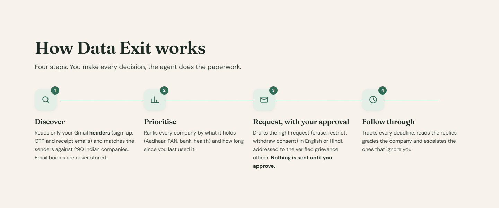
</div>

---

## 🎬 A walkthrough: follow Priya

The live demo runs on a seeded persona, **"Priya Demo"**, with a deterministic inbox of 656 messages. It never touches a real inbox, and nothing is sent to any company (`SEND_MODE=sandbox`). Every screenshot below is from the [live site](https://isozxdci5aem2ewbe7utcwv6i40oulpk.lambda-url.ap-south-1.on.aws/).

### Step 1 · Discover: "Who has my data?"

Data Exit reads Gmail **headers only** (sign-up, OTP, receipt and welcome emails) and matches senders against a directory of **290 Indian companies**. Priya's inbox turns up **214 companies**; **61** she hasn't used in 3+ years, and **12** of those hold her Aadhaar, PAN, bank or health data.

Each dot is a company. The further out it sits, the longer Priya has gone without using it; orange means it holds sensitive data. Clicking **Kotak Mahindra Bank** shows the email that revealed it, what data it probably holds, and a warning that RBI KYC rules mean the bank must keep some of it.


> **Try it:** [open the data map](https://isozxdci5aem2ewbe7utcwv6i40oulpk.lambda-url.ap-south-1.on.aws/#map) and press **Select the 12 riskiest**.

### Step 2 · Approve: one request per company, and the user signs off

Data Exit drafts one request per company, addressed to its grievance officer and citing the email it came from. Of Priya's 12, **10 are erase requests**. The **2 banks are switched to restrict-use**, because the law requires them to keep KYC records and an erase request would only be refused.


<table>
<tr>
<td width="50%" valign="top">

**Kotak gets a restrict-use request, in Hindi.** Each draft can be read in English or हिन्दी before approving. Before 13 May 2027 every request is labelled a *policy-based (courtesy)* request, and DPDP section numbers stay marked `[verify]` until they have been checked.

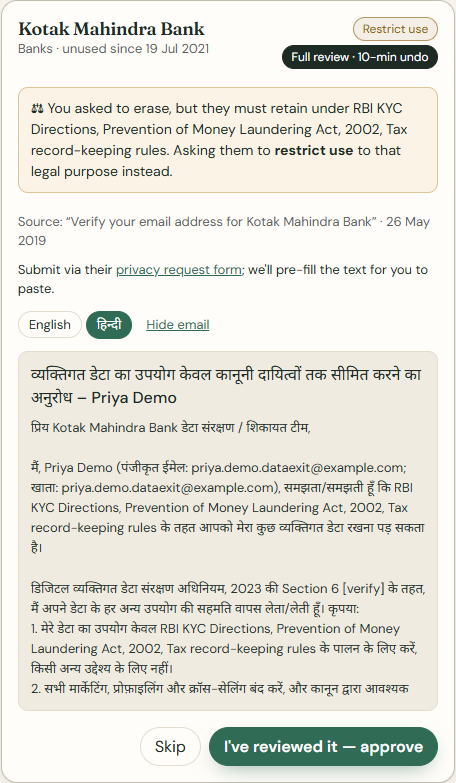

</td>
<td width="50%" valign="top">

**A 10-minute undo on every high-risk send.** Erasure, and anything sent to a bank, insurer, hospital or government body, needs a **full review** of the exact text. After approval the request waits 10 minutes before it leaves, so the user can still change their mind.

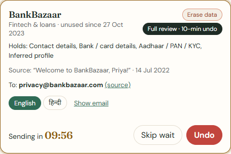

**Every action is audit-logged.** Agent proposals, user approvals and sends go into a SHA-256 hash chain that the user can verify.

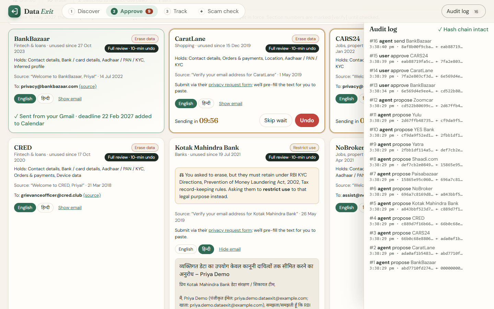

</td>
</tr>
</table>

> **Try it:** [jump straight to the 12 drafts](https://isozxdci5aem2ewbe7utcwv6i40oulpk.lambda-url.ap-south-1.on.aws/#review-demo).

### Step 3 · Track: deadlines, replies, report cards and escalation

Every request gets a 90-day deadline, which is also added to Google Calendar. Data Exit classifies the replies (confirmed, ID requested, refused for retention, redirected) and grades each company. Priya's weekly WhatsApp digest reads: *"5 confirmed deletion, 1 asked for ID, 1 ignored you. Escalate?"*

<table>
<tr>
<td width="50%" valign="top">

**Report card.** 6 of 7 companies replied, with a median reply time of 14 days. Quikr asked for ID, so Data Exit tells Priya to reply from her registered email and **never send an Aadhaar or PAN copy** unless she chooses to.


</td>
<td width="50%" valign="top">

**Gaana ignored the deadline, so escalate.** One tap drafts a grievance-officer escalation (English or Hindi) citing the original request. It still needs Priya's approval before it is sent.

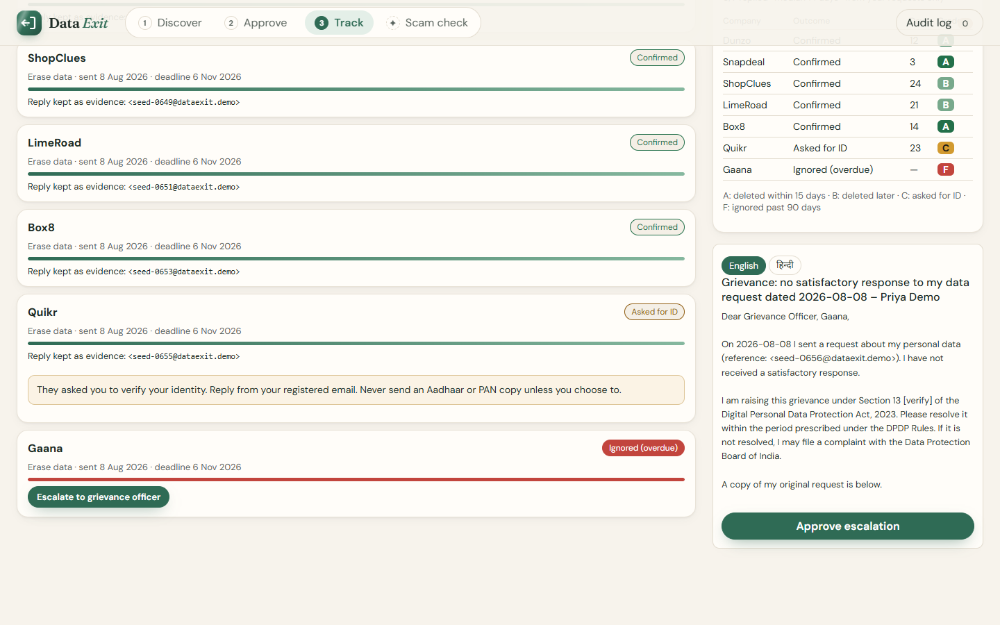

</td>
</tr>
</table>

> **Try it:** [open the tracker](https://isozxdci5aem2ewbe7utcwv6i40oulpk.lambda-url.ap-south-1.on.aws/#tracker) and press **Escalate Gaana**.

---

## ⚖️ It knows the law, so you don't hit a dead end

**RBI KYC, PMLA, SEBI, telecom, insurance and medical** retention rules turn an erase request into a **restrict-use** request, so a bank's lawful refusal isn't a dead end. Tax records are not exempt. A valid retention refusal of erasure is never escalated.

<div align="center">
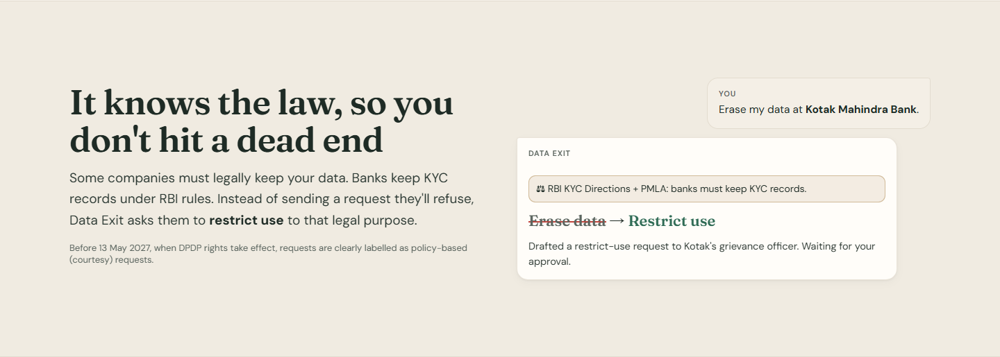
</div>

## 🛡️ You stay in control

An agent that sends legal letters for you has to be trustworthy. These rules are built into the code in `packages/policy`; they are not just promises in the UI.

<div align="center">
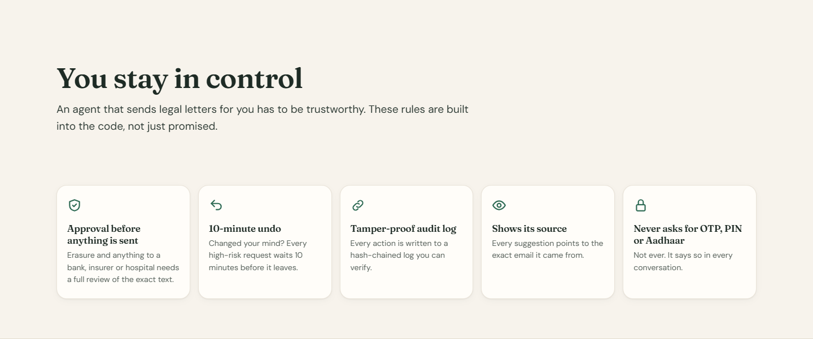
</div>

| Approval tier | What it covers | What happens |
| --- | --- | --- |
| `auto` | Stop marketing | Runs without asking **only** if the user turned on `auto_low_risk` |
| `one_tap` | Withdraw consent, access, correction, restrict | Needs one tap to approve |
| `full_review` | Erasure; **any** request to banks, insurers, government or health | Full text shown, `reviewed: true`, then a 10-minute undo window |

---

## 📱 Rural mode: "Is this message a scam?"

For people in villages, the biggest data risk is fraud, not marketing email. Forward a suspicious SMS or say it out loud, and the bot replies in **Hindi, English or Kannada** with a verdict, the reasons, and what to do next, including calling **1930**. The verdict comes from the real `check_scam` MCP tool running on **AWS Lambda (Mumbai)**, and **ElevenLabs** reads the answer aloud.


<table>
<tr>
<td width="34%" valign="top" align="center">

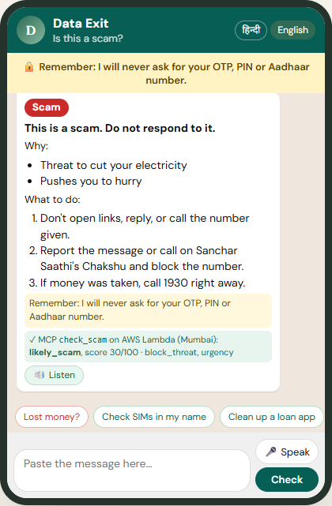

<sub>**English:** "Your electricity will be cut tonight" is flagged as a scam, with steps to report it on Sanchar Saathi's Chakshu.</sub>

</td>
<td width="66%" valign="top">

**What the rural bot always does**

- Opens **every** conversation with: *"I will never ask for your OTP, PIN or Aadhaar number."*
- Explains **why** a message is a scam (urgency, KYC threat, unknown short link, cut-off threat) so people learn the pattern.
- Gives concrete next steps: don't click, report on **Sanchar Saathi Chakshu**, call **1930** if money was taken.
- Quick actions: *Lost money?* · *Check SIMs in my name* · *Clean up a loan app*.
- Eight sample scams to try: bank KYC, electricity bill, farmer scheme, QR cashback, digital arrest, lottery, part-time job, and a **real** OTP SMS (to show it doesn't cry wolf).

> **Try it:** [open the scam check](https://isozxdci5aem2ewbe7utcwv6i40oulpk.lambda-url.ap-south-1.on.aws/#rural) and tap a sample, or press 🎤 and speak.

</td>
</tr>
</table>

## 📲 Works on a phone

Built for 390 px screens first, because that's where most users are.

<div align="center">
<table>
<tr>
<td align="center">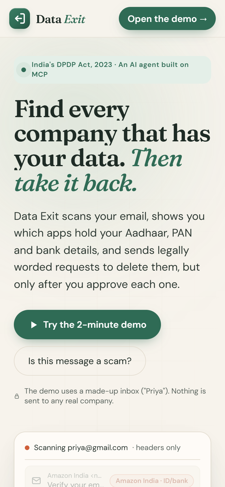<br><sub>Landing</sub></td>
<td align="center">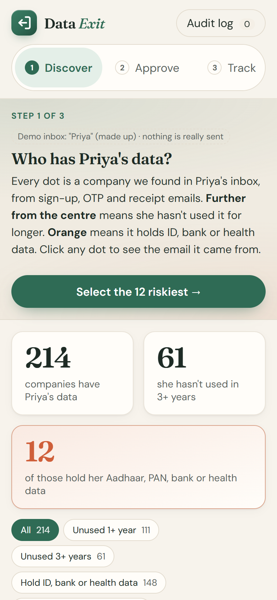<br><sub>Step 1: Discover</sub></td>
<td align="center">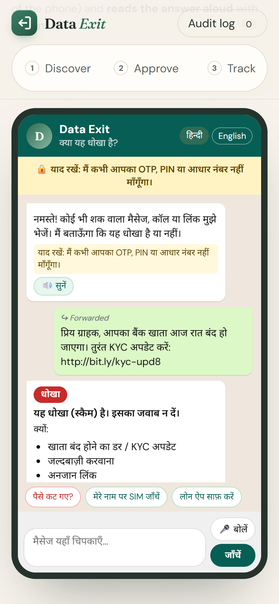<br><sub>Scam check (Hindi)</sub></td>
</tr>
</table>
</div>

---

## 🔌 Why MCP

Data Exit is **23 MCP tools across five servers**, orchestrated by Claude. A single request flows through discovery, legal reasoning, drafting, approval and follow-up. It is much more than a wrapper around one API.

<div align="center">
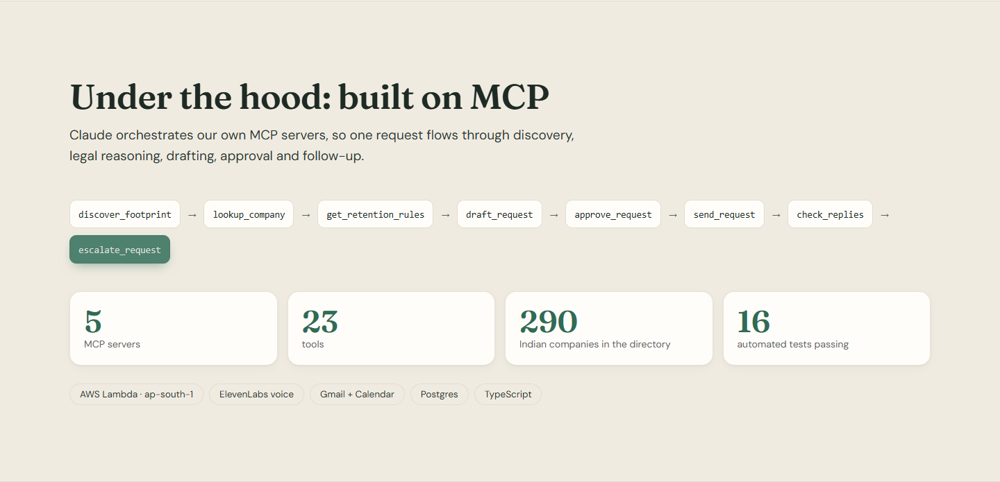
</div>

```
discover_footprint ─▶ lookup_company ─▶ get_retention_rules ─▶ draft_request ─▶ approve_request ─▶ send_request
   (Gmail, headers)     (directory)        (legal reasoning)      (EN/HI templates)   (policy tiers)     (Gmail + Calendar)
                                                                                                             │
weekly_digest ◀─ escalate_request ◀─ classify_reply ◀─ check_replies ◀───────────────────────────────────────┘
check_scam (rural mode)    export_evidence    get_audit_log (hash-chained)    delete_my_data
```

Every tool call goes through `packages/policy`: an approval-tier check plus an audit event in a SHA-256 hash chain. **The agent cannot send anything the user hasn't approved.** Details: [docs/architecture/mcp-servers.md](docs/architecture/mcp-servers.md).

<details>
<summary><b>The five-step loop in full</b></summary>

1. **Discover.** Reads Gmail *headers only* (sign-up, OTP, receipt and welcome emails) and matches senders against a 290-company Indian directory. No email bodies are stored.
2. **Prioritise.** Scores each company 0–100 on data sensitivity (Aadhaar, PAN, bank, health), breadth and dormancy, and draws a data map.
3. **Draft.** Writes the right request (withdraw consent, access, correct, erase, restrict) in English or Hindi, addressed to the verified grievance officer, citing the email it came from.
4. **Approve and send.** Approval tiers decide what needs one tap and what needs a full review. Erasure and anything sent to a bank, insurer, hospital or government body gets a full review and a 10-minute undo. Requests are sent from the user's own Gmail, with a Calendar reminder at the deadline.
5. **Follow through.** Classifies replies (confirmed, ID requested, refused for retention, redirected), escalates to the grievance officer and drafts a Data Protection Board complaint, exports an evidence ZIP, and sends a weekly digest.

</details>

## ☁️ Sponsor technology

| | Built and live today | Next (pilot) |
| --- | --- | --- |
| **AWS** | Live MVP on **AWS Lambda (ap-south-1, Mumbai)** behind a Function URL. One function serves the web app, runs the real `check_scam` MCP code at `/api/check`, and proxies ElevenLabs at `/api/tts` so the API key never reaches the browser. The deploy bundle lives in S3. | One Lambda per MCP server behind API Gateway; Step Functions + EventBridge for the 30/90-day request clocks; RDS Postgres (schema in [db/schema.sql](db/schema.sql)); S3 Object Lock + KMS for the evidence locker; Cognito + SNS. |
| **ElevenLabs** | **Multilingual TTS** reads every rural-mode verdict aloud in Hindi and English, and in **Kannada** via `eleven_v3`. Falls back to the browser's voice if offline. | **Scribe** speech-to-text for voice notes in Kannada and Hindi; **ElevenLabs Agents + Twilio** missed-call helpline for feature-phone users. |

Deployment details: [docs/architecture/deployment-aws.md](docs/architecture/deployment-aws.md).

## ✅ What's real and what's mocked

| Part | Status |
| --- | --- |
| MCP servers (discovery, directory, request engine, tracker, scam shield) | ✅ **Real.** Built and tested: `npm test` runs 16 tests (unit, Postgres store contract, end-to-end, MCP protocol). |
| Gmail discovery and sending, Calendar deadlines | ✅ **Real** via our own OAuth client. Offline fixture backend for demos (`GMAIL_BACKEND=fixture`). Live sends are disabled (`SEND_MODE=sandbox`). |
| Policy layer: tiers, 10-minute undo, hash-chained audit | ✅ **Real**, in `packages/policy`, and mirrored in the web UI (SubtleCrypto SHA-256). |
| Company directory | ✅ **Real data**: 290 Indian companies. 7 grievance contacts are verified from each company's privacy policy; the rest are `verified: false` and never guessed. |
| `check_scam` + ElevenLabs voice | ✅ **Real and live** on AWS Lambda. |
| Telegram AI and voice bot | 🟡 **Built for local testing** via long polling and Sarvam speech/chat APIs. Requires BotFather token, chat ID and Sarvam key; see [setup](apps/telegram-bot/README.md). |
| Web app (data map, approvals, tracker) | 🟡 **Real UI on seeded data**: a deterministic demo inbox of 656 messages. Next step: point `apps/web/src/api.ts` at the MCP HTTP server. |
| WhatsApp bot, SMS on Android, missed-call line | ⚪ **Designed, not built.** The rural UI is a WhatsApp-style mock-up. |

## 📊 Quality, measured

| Lighthouse | Performance | Accessibility | Best practices | SEO |
| --- | :---: | :---: | :---: | :---: |
| Desktop | 97 | 100 | 100 | 100 |
| Mobile | 90 | 100 | 100 | 100 |

16/16 tests pass · 0 console errors across all views · accessibility 100 on all 5 views · works at 390 px wide. Details and before/after numbers: [docs/hackathon/metrics.md](docs/hackathon/metrics.md).

---

## 🚀 Run it locally

Requires Node 22+.

```bash
npm install
npm test            # build + tests
npm run demo:seed   # regenerate the demo inbox and the web app's mock data
npm run web         # web app at http://127.0.0.1:5173
npm run telegram    # Telegram AI and voice bot (after local token, chat IDs and Sarvam key are set)
npm start           # all MCP tools in one server over stdio (Claude Code reads .mcp.json)
npm run start:http  # same over HTTP for claude.ai custom connectors (needs MCP_HTTP_SECRET)
```

Deep links for the demo: `#map` · `#review-demo` · `#tracker` · `#rural`.
To connect Claude Desktop, claude.ai or a real Gmail account, see [docs/development/setup.md](docs/development/setup.md). To redeploy the live site, see [docs/architecture/deployment-aws.md](docs/architecture/deployment-aws.md).

<details>
<summary><b>Repository layout</b></summary>

```
apps/web/                  Web app: data map (D3), review & approve, tracker, rural scam check (Vite + TypeScript)
apps/telegram-bot/         Local Telegram AI and voice bot for private chats and test groups
infra/voice-lambda/        AWS Lambda: serves the web app, /api/check, /api/tts (ElevenLabs)
packages/
  shared/                  Contract types, sensitivity scoring, DPDP constants
  policy/                  Approval tiers, approval state machine, hash-chained audit log
  store/                   JSON-file and Postgres stores
  google/                  OAuth, Gmail (headers-only search, UTF-8 send), Calendar, offline fixtures
  directory/               Directory loader: domains, SMS sender IDs, brand merge
  runtime/                 Config, logging, context, MCP tool wrapper
servers/
  discovery/               discover_footprint, get_data_map, check_new_signups
  company-directory/       lookup_company, get_retention_rules (+ data/companies.csv, 290 companies)
  request-engine/          draft / approve / undo / reject / send + EN/HI templates
  tracker/                 replies, escalation, evidence ZIP, digest, audit, delete
  scam-shield/             check_scam (rural mode)
  dataexit/                all tools in one server (stdio or --http) + CLI scripts
demo/seed-inbox/           Deterministic demo inbox generator (656 messages)
db/schema.sql              Postgres schema
tests/                     unit, store contract, end-to-end, MCP protocol
docs/                      Product, legal, architecture, hackathon (start at docs/README.md)
```

</details>

## 🔒 Safety and privacy by design

- Gmail **metadata first**; email bodies are never stored. SMS would be parsed on the device.
- **Never** asks for OTP, PIN or Aadhaar, and says so in every rural-mode reply.
- No grievance contact is invented. Unverified contacts are flagged, and the request is blocked until a recipient is confirmed.
- Every suggestion cites the email it came from.
- `delete_my_data` wipes everything Data Exit stored about the user.

## 👥 Team

**Team Data Exit** · Team ID **43af82f0** · Dr. Ambedkar Institute of Technology · wHACKiest 2026, Track 1: Make MCP Matter

| Member | Role |
| --- | --- |
| Abhishek M Shivanagoudar (lead) | Agent, MCP servers, AWS |
| Sanvi Y Gowda | WhatsApp, ElevenLabs voice |
| Afreen Hossain | Web app and data map |
| Rithikha R | Company directory, request templates, demo data |

Plan and status: [docs/hackathon/build-plan.md](docs/hackathon/build-plan.md) · Submission checklist: [docs/hackathon/submission.md](docs/hackathon/submission.md)

## ⚠️ Disclaimer

Data Exit is not a legal service. Request templates are drafts that need a lawyer's review before real use, and DPDP section numbers are marked `[verify]`. Before **13 May 2027**, data-principal rights under the DPDP Rules are not yet in force, so requests sent before then are policy-based (courtesy) requests.
