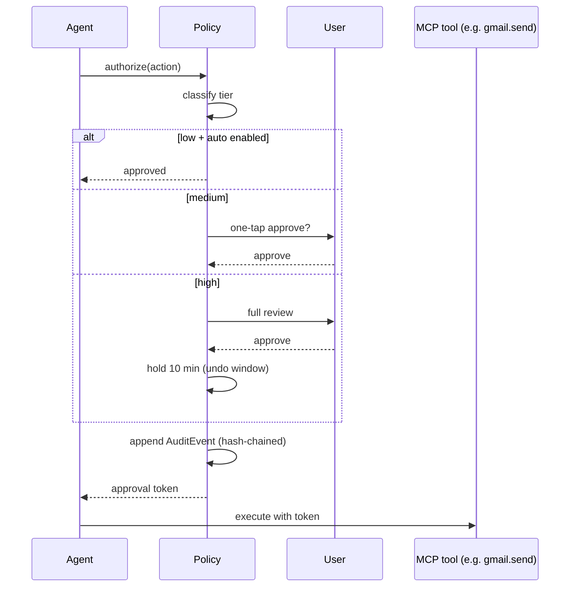

# Approval tiers and audit log

This is the "controlled" part of the pitch. Code: [`packages/policy`](../../packages/policy).

## Tiers

| Tier (code) | Examples | Behaviour |
| --- | --- | --- |
| **Low** (`auto`) | Unsubscribe, marketing opt-out | Runs without asking only when the user turned on `auto_low_risk` (`set_preferences`); otherwise needs approval |
| **Medium** (`one_tap`) | Withdraw consent, access, correction, restrict use | One-tap approval |
| **High** (`full_review`) | Erasure; any request to banks, insurers, government, health (or RBI_KYC / INSURANCE / MEDICAL companies) | Full text shown, `approve_request` with `reviewed: true`, then a **10-minute undo window** before `send_request` will send it |

Code: tiers in [`tiers.ts`](../../packages/policy/src/tiers.ts), the approval state machine (`approve`, `undo`, `reject`, `sendBlocker`) in [`approval.ts`](../../packages/policy/src/approval.ts). Every state change writes an audit event with `approval` set to `auto`, `approved`, `undone` or `rejected`.

Claude cannot approve on its own: approval tools are described as user-only, the server instructions repeat it, and Claude's own permission prompt applies to each call. Keep `approve_request` and `send_request` on "ask every time".

### Escalation rules

The tier is the **higher** of:
- the request type's base tier, and
- the company sector's floor (banks, insurers, government, health → high).

## Flow

## Audit log

- Every proposal, approval, rejection, undo, send and status change is an `AuditEvent`.
- Events are **hash-chained**: `hash = sha256(prev_hash + canonical_json(event))`. Tampering breaks the chain.
- Every event stores `source_ref` (the email/SMS message ID the suggestion came from).
- Users can export the full log.
