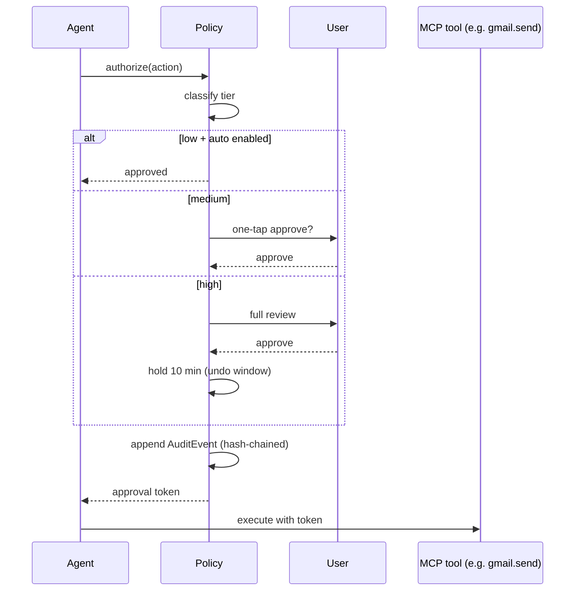

# Approval tiers and audit log

This is the "controlled" part of the pitch. Code: [`packages/policy`](../../packages/policy).

## Tiers

| Tier | Examples | Behaviour |
| --- | --- | --- |
| **Low** | Unsubscribe, marketing opt-out | Can run automatically once the user enables auto-mode for low tier |
| **Medium** | Withdraw consent, access, correction, restrict use | One-tap approval |
| **High** | Erasure; any request to banks, insurers, government, health | Full review, then a **10-minute undo window** before sending |

### Escalation rules

The tier is the **higher** of:
- the request type's base tier, and
- the company sector's floor (banks, insurers, government, health → high).

## Flow

## Audit log

- Every proposal, approval, rejection, undo, send and status change is an `AuditEvent`.
- Events are **hash-chained**: `hash = sha256(prev_hash + canonical_json(event))`. Tampering breaks the chain.
- Every event stores `source_ref` (the email/SMS message ID the suggestion came from).
- Users can export the full log.
