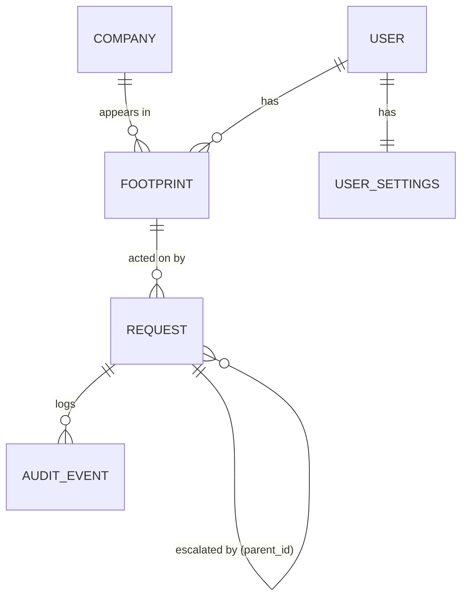
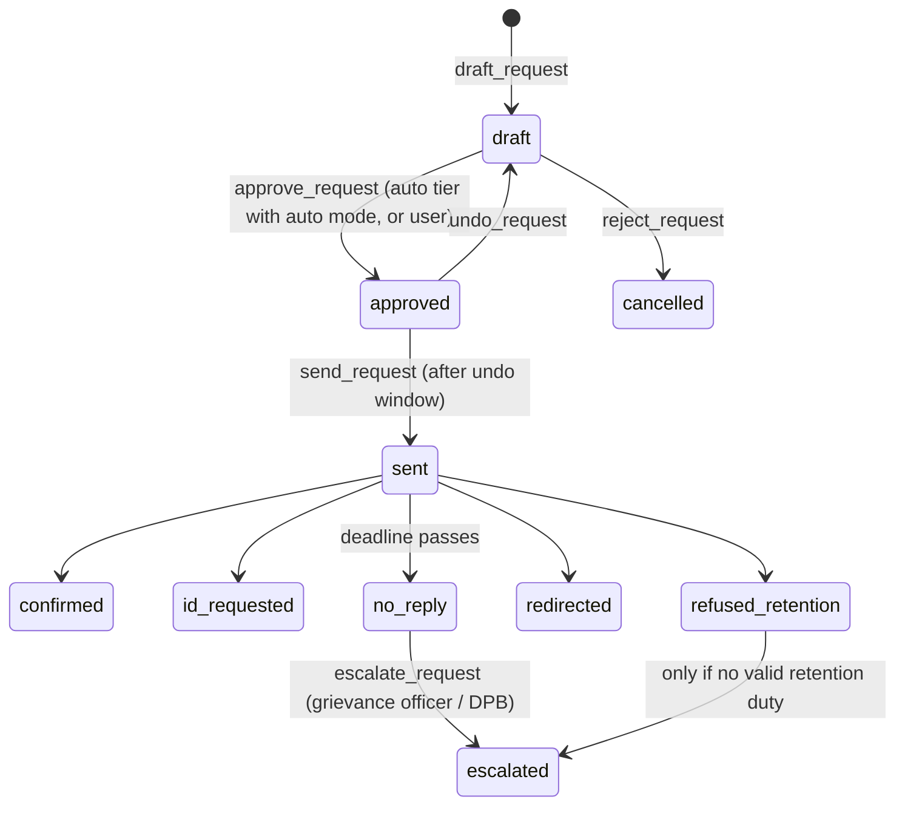

# Data model

Field-by-field definitions are in the interface contract: [docs/contract.md](../contract.md). TypeScript: [`packages/shared/src/types.ts`](../../packages/shared/src/types.ts). SQL: [`db/schema.sql`](../../db/schema.sql).

## Storage

| Store | When | Notes |
| --- | --- | --- |
| `FileStore` (`.data/store.json`) | default, all-in-one server | one JSON file, writes serialised in-process, atomic rename |
| `SqlStore` (Postgres) | `DATABASE_URL` set | footprints/requests/settings as JSONB documents with indexed columns; audit events as columns; appends serialised per user with an advisory lock |

Both implement the same `Store` interface ([`packages/store`](../../packages/store/src/types.ts)) and pass the same contract test. The Postgres path is tested on PGlite (Postgres compiled to WebAssembly), not yet on a hosted Postgres.

## Request lifecycle

Escalations are child requests (`parent_id`, `escalation_level`) that go through the same approve/send pipeline. DPB complaint drafts have `sendable: false`.
