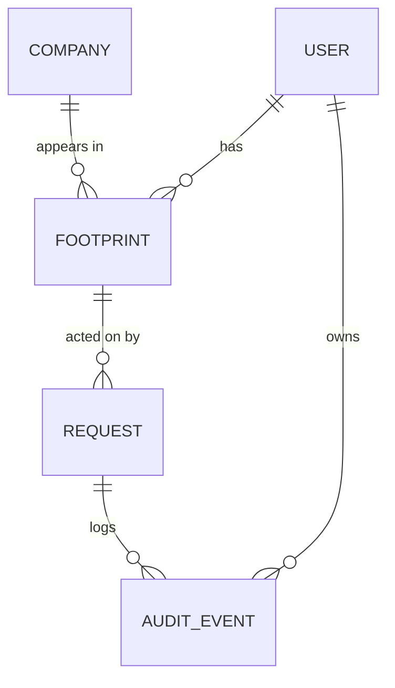

# Data model

TypeScript: [`packages/shared/src/types.ts`](../../packages/shared/src/types.ts). SQL: [`db/schema.sql`](../../db/schema.sql).

## Company (shared directory)

| Field | Notes |
| --- | --- |
| `id` | slug, e.g. `swiggy` |
| `name`, `domains[]` | domains used for sender matching |
| `sector` | e-commerce, food, social, bank, fintech, telecom, health, travel, edtech, gaming, utility, government, insurance |
| `data_categories[]` | from the [sensitivity ladder](../legal/data-taxonomy.md) |
| `retention_duties[]` | `rbi_kyc`, `pmla`, `telecom_licence`, `tax`, `medical` |
| `grievance_contact` | email / URL / officer name; `verified` flag, `source`, `last_checked` |
| `privacy_policy_url` | |

## Footprint (per user)

| Field | Notes |
| --- | --- |
| `user_id`, `company_id` | |
| `first_seen`, `last_seen` | from message dates |
| `discovered_via` | `gmail`, `sms`, `google_signin`, `manual` |
| `source_refs[]` | message IDs (never bodies) |
| `sensitivity` | 1–12, highest category |
| `status` | `active`, `dormant`, `request_open`, `closed` |

## Request

| Field | Notes |
| --- | --- |
| `type` | `stop_marketing`, `withdraw_consent`, `access`, `correct`, `erase`, `restrict_use` |
| `tier` | `low`, `medium`, `high` |
| `language` | `en`, `hi` |
| `legal_basis` | `statutory` or `policy_based` (before 13 May 2027) |
| `status` | `draft`, `awaiting_approval`, `in_undo_window`, `sent`, `acknowledged`, `id_requested`, `confirmed`, `rejected`, `overdue`, `escalated_go`, `escalated_dpb`, `closed`, `cancelled` |
| `sent_at`, `deadline_at` | deadline = sent + 90 days |
| `gmail_message_id`, `calendar_event_id` | |

## AuditEvent (hash-chained, append-only)

| Field | Notes |
| --- | --- |
| `seq` | per-user sequence |
| `actor` | `user`, `agent`, `helper:<id>`, `system` |
| `action` | `propose`, `approve`, `reject`, `undo`, `send`, `status_change`, `export`, `delete_account` |
| `target` | request / footprint id |
| `source_ref` | message ID the action came from |
| `prev_hash`, `hash` | sha256 chain |
