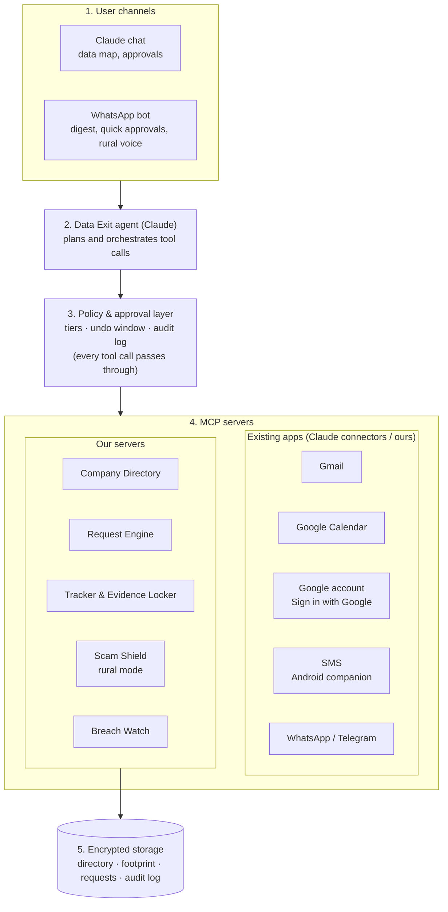
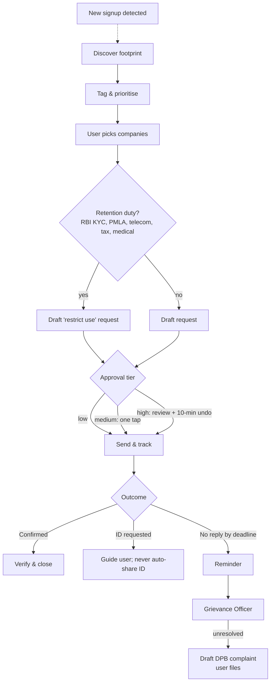

# Architecture overview

## Layers

| Layer | Where in repo |
| --- | --- |
| Channels | `apps/web`, `apps/whatsapp-bot` (Person B) |
| Agent | Claude; server instructions and tool descriptions in `packages/runtime/src/mcp.ts` and `servers/*/src/tools.ts` |
| Policy & approval | `packages/policy` (tiers, approval state machine, audit chain) |
| Our MCP servers | `servers/discovery`, `company-directory`, `request-engine`, `tracker`, `scam-shield`; all-in-one `servers/dataexit` |
| Gmail / Calendar access | `packages/google` (OAuth, Gmail API headers-only search, UTF-8 send, Calendar; offline fixtures) |
| Storage | `packages/store` (JSON file or Postgres), `db/schema.sql` |

## Process flow

A bank citing RBI KYC rules gets a **restrict use** request instead of escalation.

## Tech stack

- Agent: Claude via MCP.
- MCP servers: TypeScript MCP SDK (see [../decisions/0001-typescript-monorepo.md](../decisions/0001-typescript-monorepo.md)).
- Storage: Postgres + encrypted per-user store.
- Graph widget: D3 or Cytoscape.
- WhatsApp Business API behind our own MCP server.
- Reply classification: rules first, LLM fallback.
