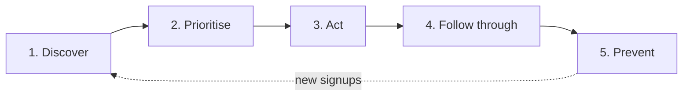

# Vision

## Hackathon brief

> Build an MCP-powered solution a regular person would actually use every day: intelligent agents that work with the apps, services and tools people already rely on. Go beyond basic integrations, with useful, reliable and controlled interactions that make everyday tasks simpler.

Judging keywords: **everyday, existing apps, beyond basic integrations, useful, reliable, controlled.** See [../hackathon/judging-map.md](../hackathon/judging-map.md).

## One-line pitch

An MCP-powered personal agent that finds every company holding an Indian user's personal data and helps them withdraw consent, correct or erase it under the DPDP Act, 2023. It works inside Gmail, SMS, Calendar and WhatsApp, and the user approves every sensitive action. A rural mode extends it into a voice-first scam shield for village users.

**Positioning:** "Mine and Permission Slip proved people want this in Europe and the US. India now has the law but no consumer tool. Data Exit is the DPDP-native, MCP-powered agent that works where Indians already are."

## Problem

- Users have given data to hundreds of companies and don't know who holds what. Mine (EU) reports about 90% of these companies are findable in the inbox; the average user has 350–400 companies, about 80% no longer used.
- In India, signups often include Aadhaar, PAN, KYC video and UPI details, and many use phone OTP rather than email.
- Exercising rights today means finding grievance officers, writing legal requests and chasing replies for up to 90 days, so almost nobody does it.
- **Why now:** breach and fraud risk, spam and loan-app harassment, and the DPDP Act has just started coming into force with no consumer tool to use it.

## Solution: the five-step loop

1. **Discover**: scan signup, welcome, OTP and receipt emails and SMS, plus Sign in with Google connections, to build a live data map.
2. **Prioritise**: tag each company with data categories, sensitivity, last-used date and retention duty; surface the riskiest dormant accounts first.
3. **Act**: draft the right request (stop marketing, withdraw consent, access, correct, erase, restrict use) in English or Hindi.
4. **Follow through**: track legal deadlines, classify replies, escalate to the grievance officer, then draft a Data Protection Board complaint; keep an evidence locker.
5. **Prevent**: at each new signup, summarise the privacy policy and offer auto-expiry; weekly digest; breach alerts.

Every suggestion shows the email or SMS it came from. Every action is logged. Sensitive actions need approval (see [../architecture/approval-and-audit.md](../architecture/approval-and-audit.md)).

## Wow moment

1. User asks: **"Who has my data?"**
2. Graph appears: *"214 companies, 61 unused for 3 years, 12 hold your Aadhaar, PAN or bank details."*
3. User taps the 12. Agent flags 2 banks that must keep KYC data and proposes **restrict use** for them.
4. User approves. Requests go out from their own Gmail; deadlines land in Google Calendar.
5. WhatsApp digest later: *"5 confirmed deletion, 1 asked for ID, 1 ignored you. Escalate?"*

Full script: [../hackathon/demo-script.md](../hackathon/demo-script.md).

## Impact

- Smaller breach and fraud exposure.
- Makes a new law usable for ordinary people, in their language.
- Company report cards from pooled, anonymised response data.

**Metrics:** companies found per user, requests sent, completion rate, median response time, escalations resolved, high-sensitivity accounts closed.
